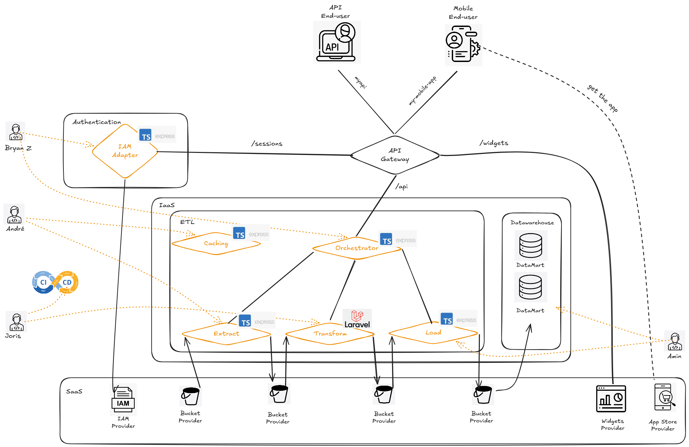

# CPNV-ES-BI-2026-2026-DEVTEAM-02

## Introduction

Welcome to the ETL Platform project!

This project is an educational initiative designed to introduce students and developers to modern software engineering practices through the development of a real-world-inspired ETL (Extract, Transform, Load) platform.

The project follows a microservices-based architecture, encouraging developers to explore distributed systems, service communication, data processing, software architecture, and collaborative development.

Its primary objective is not simply to build a functional application, but also to provide a practical environment where developers can learn, experiment, make mistakes, and progressively develop their engineering skills.

## About the Project

ETL stands for:

Extract – Retrieve data from various external sources.

Transform – Process, normalize, validate, and enrich the extracted data.

Load – Transfer the processed data into a target system.

The platform aims to demonstrate how an ETL workflow can be implemented using independently developed and interconnected microservices.

Each service has a dedicated responsibility and communicates with other services through well-defined interfaces.

This approach provides an opportunity to understand how modern applications are designed, structured, developed, tested, and maintained.

## Architecture

The project is built around a microservices architecture, where each component is responsible for a specific part of the ETL process.

The architecture encourages:

* Separation of concerns.
* Loose coupling between services.
* Clear service boundaries and responsibilities.
* Independent development and testing.
* Well-defined communication contracts.
* Scalability and maintainability.

### High-level architecture

### Roadmap

* [Sprint 1](./sprint01.md)
